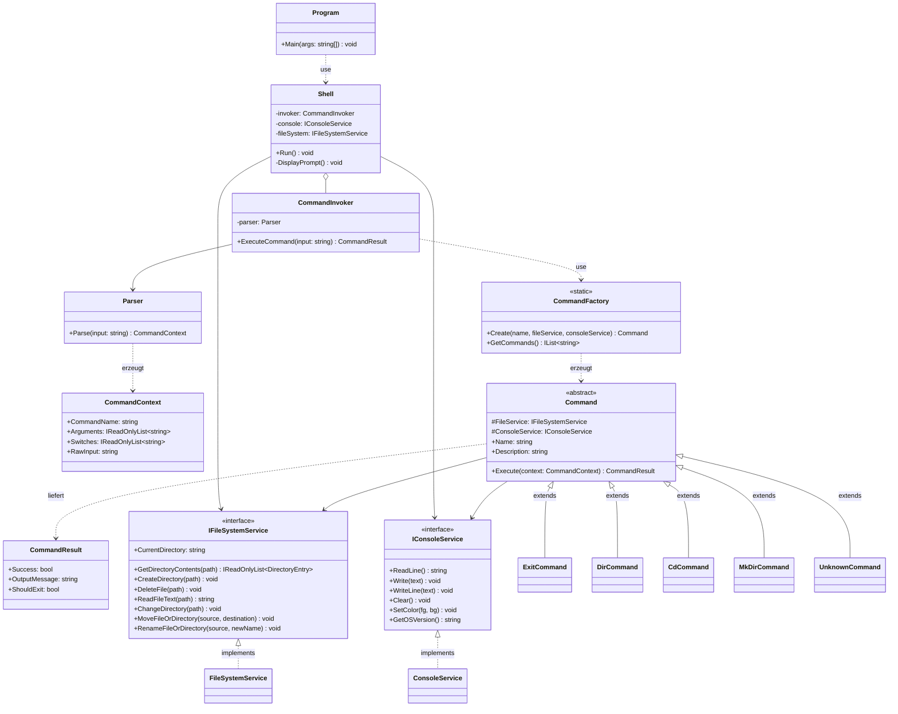
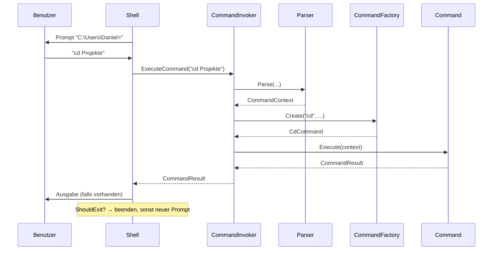

# Architektur – Command Shell (Version 2)

Version 2 basiert auf der Musterlösung der Lehrperson ([musterloesung-v1.png](musterloesung-v1.png)) und übernimmt die Teile aus unserem ersten Entwurf, die sich bewährt haben.

## Klassendiagramm

Die übrigen Befehle (Type, More, Ren, Ver, Cls, Move, SetColor, Del) erben genauso von `Command`. Sie fehlen im Diagramm nur, damit es übersichtlich bleibt.

## Ablauf einer Eingabe

## Rollen aus den Patterns

| Pattern | Rolle | Klasse |
|---|---|---|
| Command | Invoker | `CommandInvoker` |
| Command | Command (abstrakt) | `Command` |
| Command | ConcreteCommand | `DirCommand`, `CdCommand`, … |
| Command | Receiver | `FileSystemService`, `ConsoleService` |
| Simple Factory | Factory | `CommandFactory` |
| Simple Factory | Product | `Command` |

## Entscheide (Abweichungen von der Musterlösung)

| # | Musterlösung | Wir | Warum |
|---|---|---|---|
| 1 | `Execute(string param): void` | `Execute(CommandContext): CommandResult` | Ohne Rückgabe weiss die Shell nicht, wann EXIT kommt. Ausserdem gehen Switches und mehrere Argumente in einem String verloren. |
| 2 | keine Services | `IFileSystemService`, `IConsoleService` | DoD: `Console`/`File` nur in den Services. So sind Unit Tests mit Fakes möglich (Dependency Inversion). |
| 3 | `static Create(string)` | `static Create(name, fileService, consoleService)` | Die Commands brauchen die Services. Die Factory reicht sie weiter. |
| 4 | Parser gibt `string` zurück | Parser gibt `CommandContext` zurück | Befehl, Switches und Argumente sind getrennt (siehe Auftrag 2). |
| 5 | – | `UnknownCommand` | Bei unbekannten Befehlen muss niemand auf `null` prüfen. |
| 6 | `ICommand` + `AbstractCommand` (unser V1) | nur `abstract class Command` | wie «Command Pattern mit abstrakter Klasse» im Unterricht |

## Fehler in der Musterlösung (zur Diskussion)

- `ExitCommand.Execute(): void` hat keinen Parameter, die Oberklasse verlangt aber `Execute(string param)`. Das ist kein gültiger Override und verstösst gegen Liskov.
- Wie EXIT die Shell beendet, ist nicht modelliert.
- `ParseCommand(String): Sring` hat einen Tippfehler.

## Miro

- Klassendiagramm: https://miro.com/app/board/uXjVHwm6kzI=/?moveToWidget=3458764683570620898
- Ablaufdiagramm: https://miro.com/app/board/uXjVHwm6kzI=/?moveToWidget=3458764681694670076
