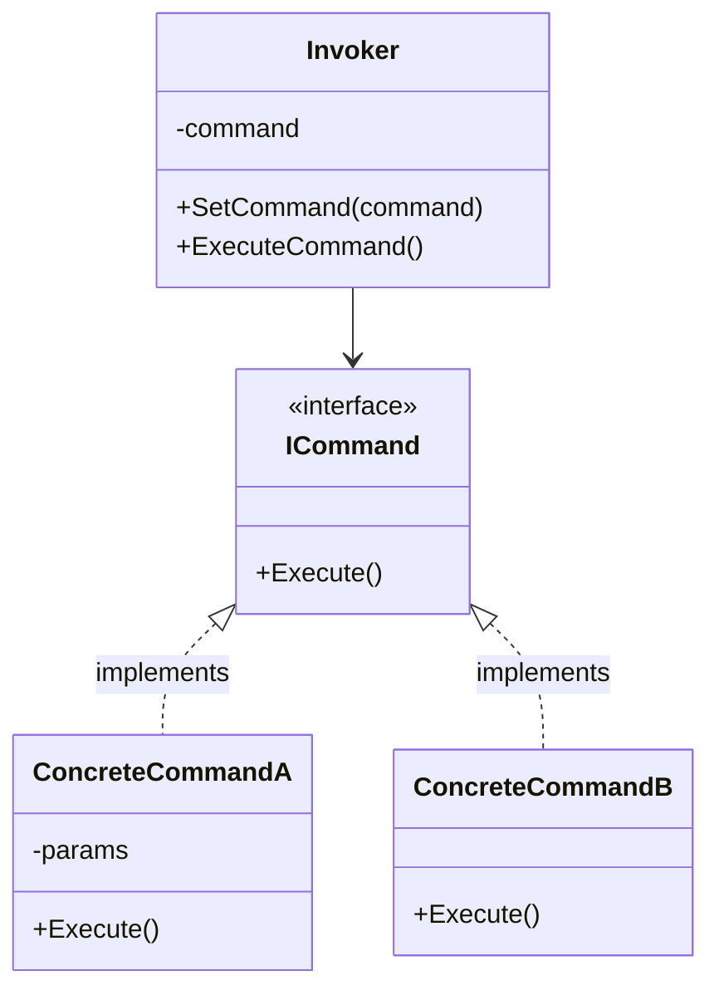
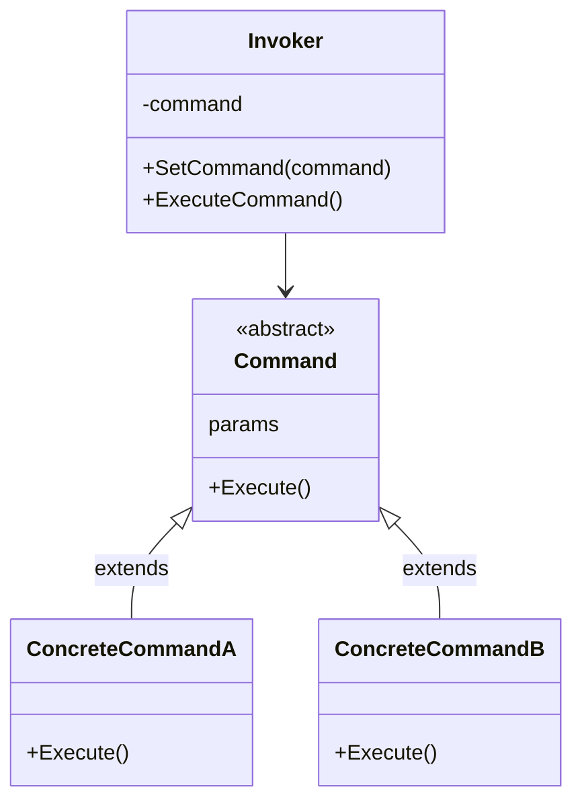
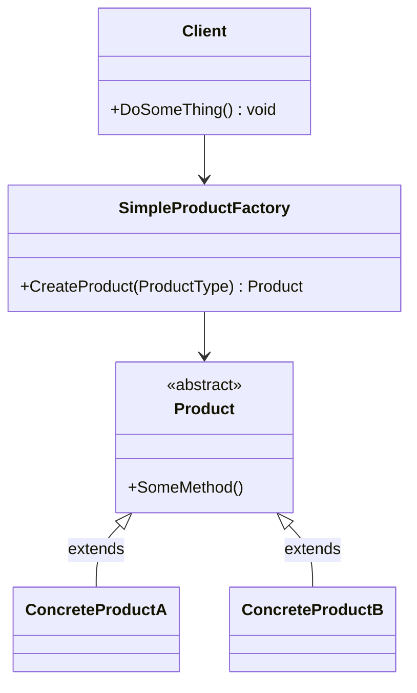

# 06 – Design Patterns: Command und Simple Factory

## Command Pattern

**Idee:** Jeder Befehl wird ein **eigenes Objekt** mit einer `Execute()`-Methode. Wer den Befehl auslöst (Invoker), muss nicht wissen, was er genau tut.

### Variante mit Interface



### Variante mit abstrakter Klasse

Statt eines Interfaces kann man auch eine **abstrakte Klasse** verwenden. Das macht unser Projekt so.



| Rolle | Aufgabe | Bei uns |
|---|---|---|
| **Command** | gemeinsame Schnittstelle `Execute()` | `Command` (abstrakt) |
| **ConcreteCommand** | ein bestimmter Befehl | `DirCommand`, `CdCommand`, … |
| **Invoker** | löst den Befehl aus | `CommandInvoker` |
| **Receiver** | macht die eigentliche Arbeit | `FileSystemService`, `ConsoleService` |
| **Client** | stellt alles zusammen | `Program` / `Shell` |

**Vorteil:** Neue Befehle kommen dazu, ohne den Invoker zu ändern (Open-Closed).

## Simple Factory (Factory Method)

**Idee:** Eine Klasse ist **allein zuständig für das Erzeugen** von Objekten. Der Client sagt nur, *welches* Objekt er will, und nicht, *wie* es gebaut wird.



```csharp
// Client-Code
Product product = SimpleProductFactory.CreateProduct(typeof(ProductType));
product.SomeMethod();
```

| Factory-Begriff | Bei uns |
|---|---|
| `SimpleProductFactory` | `CommandFactory` (static) |
| `CreateProduct(type)` | `Create(name)` → liefert ein `Command` |
| `Product` | `Command` |
| `ConcreteProductA/B` | `DirCommand`, `CdCommand`, … |

## Beide Patterns zusammen

```
Eingabe "dir"
   │
   ▼
CommandInvoker ──► Parser.Parse("dir")            → CommandContext
               ──► CommandFactory.Create("dir")   → DirCommand   ← Simple Factory
               ──► command.Execute(context)       → CommandResult ← Command Pattern
```

### `if/else` und `switch` ersetzen

Die Factory braucht kein langes `switch`. Ein **Dictionary** ordnet jedem Namen das passende Command zu:

```csharp
private static readonly Dictionary<string, Func<Command>> Commands = new()
{
    { "dir", () => new DirCommand() },
    { "cd",  () => new CdCommand() },
};
```

Die Übung «Ü6 Refactoring» stellt dieselbe Frage: Wie ersetzt man `if-else-if` oder `switch`? Eine Tabelle bzw. ein Dictionary ist eine mögliche Antwort.

Quelle: Unterricht M426, T4 «04 Command Pattern», «05 Factory Method Pattern»; https://refactoring.guru/design-patterns
